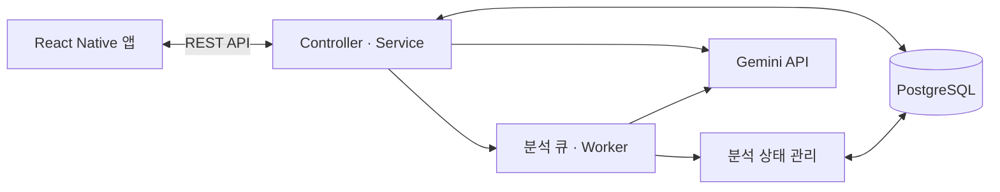
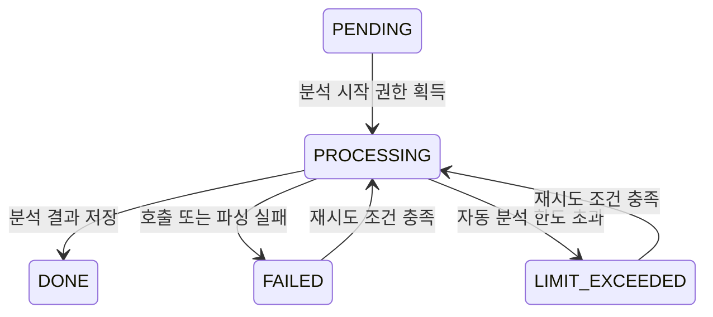

# ReadMe Backend

**ReadMe 독서 앱의 파일·독서 데이터, AI 분석, 추천을 처리하는 Spring Boot 서버입니다.**

앱 화면과 서버를 별도 저장소에서 관리합니다. 서비스 전체 소개와 사용자 흐름은 **[ReadMe 앱 README](https://github.com/16eunda/readMe#readme)**에서 볼 수 있습니다.

| 저장소 | 역할 |
| --- | --- |
| [readMe](https://github.com/16eunda/readMe) | TypeScript·React Native·Expo 앱 |
| **[readMe-backend](https://github.com/16eunda/readMe-backend)** | Java·Spring Boot API, PostgreSQL, Gemini 연동 |

## 주요 기능

- JWT 로그인·토큰 재발급·로그아웃과 로그인 세션 관리
- 파일·폴더 등록·조회·수정·삭제, 검색과 독서 진행 상태 저장
- 계정·기기별 데이터 소유 범위 확인
- Gemini 기반 장르·키워드·분위기·요약 생성 및 분석 결과 수정
- 비동기 분석 큐, 처리 상태 관리, 재시도 대상 복원
- 장르·키워드와 독서 이력을 활용한 추천
- 구독 상태 확인과 Google Play 구독 연동

## 기술 스택

Java 17 · Spring Boot 3.5 · Spring Data JPA · Spring Security · PostgreSQL · JWT · Gemini API · Gradle · Docker

## 처리 구조



원본 TXT·EPUB 파일은 앱의 기기 저장소에서 읽습니다. 서버는 파일 메타데이터·미리보기·독서 상태·AI 분석 정보를 저장하고, Gemini 호출 시 제목과 미리보기 텍스트를 전달합니다.

## 주요 설계

### 분석 상태를 기준으로 중복 호출 제어

백그라운드 분석과 사용자의 분석 정보 조회가 겹칠 수 있으므로, 조회 후 저장하는 방식 대신 조건부 `UPDATE`로 처리 권한을 구분합니다. 분석 상태를 가져온 요청이 모델을 호출하고, 다른 요청은 완료 결과를 확인합니다.



메모리 큐는 서버 재시작 시 사라지므로, 스케줄러가 DB 상태를 기준으로 처리 대상을 다시 구성합니다. 장기간 남아 있는 `PROCESSING`도 재시도 대상으로 다룹니다.

구현: [AnalysisStateService](src/main/java/com/ReadMe/demo/service/AnalysisStateService.java) · [FileRepository](src/main/java/com/ReadMe/demo/repository/FileRepository.java) · [AnalysisBacklogScheduler](src/main/java/com/ReadMe/demo/worker/AnalysisBacklogScheduler.java)

### AI 분석 결과와 독서 상태의 갱신 범위 분리

분석을 기다리는 동안 앱에서 읽던 위치·폴더·별점이 바뀔 수 있습니다. 분석 결과를 저장할 때 파일 전체의 오래된 상태를 다시 반영하지 않도록, 분석 상태·결과 컬럼의 갱신을 분리하고 변경된 컬럼만 업데이트하도록 구성했습니다.

구현: [AnalysisStateService](src/main/java/com/ReadMe/demo/service/AnalysisStateService.java) · [FileEntity](src/main/java/com/ReadMe/demo/domain/FileEntity.java)

### 소유 범위를 확인한 조회·수정·결과 재사용

로그인 사용자는 계정 기준, 비회원은 기기 식별자와 계정 미연결 조건(`user IS NULL`)을 기준으로 파일을 조회합니다. AI 결과 조회·수정과 같은 제목의 기존 분석 결과 재사용도 본인 소유 범위 안에서 처리합니다.

구현: [AiAnalysisService](src/main/java/com/ReadMe/demo/service/AiAnalysisService.java) · [FileRepository](src/main/java/com/ReadMe/demo/repository/FileRepository.java)

### 외부 응답과 추천 데이터 부족 처리

Gemini 연결·응답 타임아웃, JSON 파싱, 저장 필드 길이 제한과 실패 상태 기록을 구현했습니다. 추천은 장르·키워드 일치 점수 기반이며, 후보가 부족하면 대체 추천을 제공합니다. `GOOD` / `LOW_DATA` / `NO_DATA`는 규칙에 따른 안내 상태로, 추천 정확도의 측정값은 아닙니다.

구현: [GeminiService](src/main/java/com/ReadMe/demo/service/GeminiService.java) · [RecService](src/main/java/com/ReadMe/demo/service/RecService.java)

## 대표 API

| 기능 | 메서드 | 경로 |
| --- | --- | --- |
| 로그인 / 토큰 재발급 | `POST` | `/auth/login`, `/auth/refresh` |
| 파일 등록 / 목록 조회 | `POST`, `GET` | `/files` |
| 파일 정보 수정 | `PATCH` | `/files/{id}` |
| 파일 검색 | `GET` | `/files/search` |
| 독서 진행 상태 저장 | `PATCH` | `/files/{id}/progress` |
| AI 분석 정보 조회 / 수정 | `GET`, `PATCH` | `/files/{id}/ai-info` |
| 추천 조회 | `GET` | `/recommendations` |
| 폴더 목록 조회 / 생성 | `GET`, `POST` | `/folders` |
| 구독 상태 확인 | `GET` | `/subscriptions/status` |

로그인 요청은 `Authorization: Bearer <accessToken>`, 비회원 데이터 접근은 `X-Device-Id`를 사용합니다. AI 분석·추천 등은 서버에서 구독 권한을 확인합니다. 상세 요청·응답은 [controller](src/main/java/com/ReadMe/demo/controller)와 [dto](src/main/java/com/ReadMe/demo/dto)를 기준으로 확인할 수 있습니다.

## 로컬 실행

### 1. 준비

- JDK 17
- PostgreSQL 데이터베이스와 접속 계정
- AI 분석을 실행할 경우 Gemini API 키

```bash
git clone https://github.com/16eunda/readMe-backend.git
cd readMe-backend
```

### 2. 환경 설정

저장소 루트의 `.env`를 아래 형식으로 작성하고 자신의 값으로 채웁니다. 서버는 시작 시 루트 `.env`를 읽으며, OS 환경변수가 있으면 해당 값을 우선합니다.

```dotenv
DATABASE_HOST=localhost
DATABASE_PORT=5432
DATABASE_NAME=readme
DATABASE_USERNAME=readme
DATABASE_PASSWORD=your_local_database_password
JWT_SECRET=your_random_secret_at_least_64_bytes
GEMINI_API_KEY=your_gemini_api_key
PORT=10000
```

`JWT_SECRET`은 HS512에 사용할 수 있도록 64바이트 이상의 충분히 긴 랜덤 값으로 설정합니다. 예를 들어 `openssl rand -hex 64`로 생성한 값을 사용할 수 있습니다.

기본 datasource 설정은 SSL 접속을 요구합니다. SSL을 사용하지 않는 **로컬 개발 DB**를 연결할 때는 다음처럼 URL을 명시해 실행합니다.

```bash
SPRING_DATASOURCE_URL='jdbc:postgresql://localhost:5432/readme?sslmode=disable' \
  ./gradlew bootRun --args='--spring.profiles.active=dev'
```

SSL 접속을 지원하는 DB에 `.env`를 맞춰 둔 경우에는 다음과 같이 실행합니다.

```bash
./gradlew bootRun --args='--spring.profiles.active=dev'
```

앱의 `pnpm android:local` 스크립트는 Android 에뮬레이터에서 이 서버의 `10000` 포트로 연결합니다. 구독 구매 검증은 Google Play 설정과 별도 서비스 계정 자격증명이 필요합니다. 결제 테스트를 하지 않는 기본 개발 설정과 구분해 준비합니다.

### 3. 테스트

```bash
./gradlew test
```

테스트 설정은 PostgreSQL 호환 모드의 H2와 테스트용 값을 사용합니다. 외부 DB나 실제 API 키를 준비하지 않고 테스트를 실행하도록 구성되어 있습니다.

대표 테스트 항목:

- 분석 중 저장한 독서 위치·폴더·별점 보존
- 분석과 조회가 겹칠 때 동일 결과 공유
- 실패 파일의 재시도와 서버 재시작 후 분석 큐 복원
- 로그인·비회원 데이터 경계와 로그인 세션 처리
- 구독 권한 및 구독 복원 처리

코드: [AnalysisLifecycleIntegrationTest](src/test/java/com/ReadMe/demo/service/AnalysisLifecycleIntegrationTest.java) · [AccountFileBoundaryIntegrationTest](src/test/java/com/ReadMe/demo/controller/AccountFileBoundaryIntegrationTest.java) · [LoginSessionIntegrationTest](src/test/java/com/ReadMe/demo/controller/LoginSessionIntegrationTest.java)

### Docker 빌드

```bash
docker build -t readme-backend .
```

멀티 스테이지 빌드로 최종 이미지에는 실행 JAR을 복사합니다. Dockerfile의 빌드는 테스트를 생략하므로 `./gradlew test`는 별도로 실행합니다. 컨테이너 실행 시 DB 접속 정보·포트·API 키를 환경변수로 전달해야 합니다.

## 현재 한계와 개선 방향

- AI 분석에는 앱에서 추출한 짧은 미리보기를 사용합니다. 현재 앱의 미리보기는 최대 200자이며 서버의 입력 상한은 2,000자입니다. 작품 전체에 대한 분석으로 간주하지 않습니다.
- 모델에 근거 없는 내용을 비우도록 요청하지만 사실 정확성을 보장하지는 않습니다. 분석용 텍스트 추출 범위와 분류 일관성을 비교하는 평가가 개선 방향입니다.
- 추천은 장르·키워드 기반 규칙을 사용합니다. 사용자 선택·수정 데이터를 바탕으로 추천 적합성을 평가하는 단계가 남아 있습니다.
- H2 기반 테스트와 실제 PostgreSQL의 동작 차이는 별도의 PostgreSQL 통합 환경에서 확인할 필요가 있습니다.
